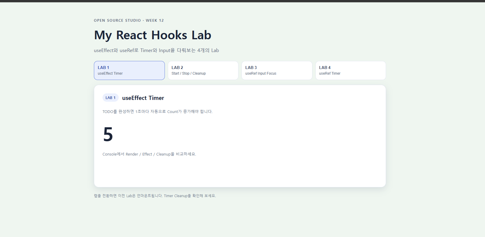

# My React Hooks Lab

## 1. Project Information

useEffect와 useRef를 사용해서 4개의 Lab을 완성한 React 프로젝트이다.

- Starter Project: https://github.com/2026-2-OSS/week12_starter_project
- 사용 기술: React 19 / Vite 6

## 2. Installation

```bash
npm install
npm run dev
```

브라우저에서 http://localhost:5173 을 열면 LAB 1~4 탭이 나온다.

실행 화면



## 3. Source Code Exploration

### 파일 구조

src/
App.jsx: 탭으로 Lab을 고르고 선택한 Lab 컴포넌트를 보여준다
App.css: 전체 화면 스타일
components/
Lab1_EffectTimer.jsx: useEffect로 자동 증가 타이머
Lab2_TimerControl.jsx: running State로 Start / Stop / Reset 동작함
Lab3_InputFocus.jsx: useRef로 input에 Focus
Lab4_RefTimer.jsx: useRef에 Timer ID 저장

App.jsx는 active State로 지금 보여줄 Lab을 정한다. 다른 탭을 누르면 이전 Lab은 화면에서 사라지기 때문에 Cleanup이 실행된다.

### useEffect

useEffect는 렌더링이 끝난 뒤에 실행되는 함수이다. Dependency Array에 넣은 값이 바뀔 때만 다시 실행된다. []이면 처음 한 번만 실행되고 생략하면 렌더링할 때마다 실행된다. return으로 돌려준 함수가 Cleanup이고 Effect가 다시 실행되기 전이나 컴포넌트가 사라질 때 실행된다.

### useRef

useRef는 .current 속성에 값을 담아두는 상자이다. 렌더링이 다시 일어나도 값이 유지된다. useState는 값을 바꾸면 화면이 다시 그려지지만 useRef는 .current를 바꿔도 화면이 다시 그려지지 않는다. 그래서 화면에 안 보이는 값이나 DOM 요소를 저장할 때 쓴다.

### 주요 코드 1 (useEffect / LAB 2)

```jsx
useEffect(() => {
  if (!running) return;

  const id = setInterval(() => {
    setCount((prev) => prev + 1);
  }, 1000);

  return () => clearInterval(id);
}, [running]);
```

running이 Dependency Array에 있어서 running이 바뀔 때마다 Effect가 다시 실행된다. running이 true면 타이머를 만들고 false면 아무것도 안 한다. running이 바뀌면 먼저 Cleanup이 이전 타이머를 지우기 때문에 타이머가 두 개 돌지 않는다.

### 주요 코드 2 (useRef / LAB 4)

```jsx
const start = () => {
  if (timerRef.current) return;

  timerRef.current = setInterval(() => {
    setCount((prev) => prev + 1);
  }, 1000);
  setRunning(true);
};

const stop = () => {
  clearInterval(timerRef.current);
  timerRef.current = null;
  setRunning(false);
};
```

setInterval이 돌려주는 Timer ID를 timerRef.current에 저장한다. 이미 ID가 있으면 start에서 바로 return해서 중복 실행을 막는다. stop에서는 저장해둔 ID로 타이머를 지우고 null로 바꾼다.

## 4. Lab Implementation

LAB 1 (Lab1_EffectTimer.jsx)

useEffect 안에서 setInterval로 1초마다 setCount(prev => prev + 1)을 실행했다. Dependency Array는 []로 두어서 처음 한 번만 타이머를 만들고 Cleanup에서 clearInterval로 타이머를 지웠다.

LAB 2 (Lab2_TimerControl.jsx)

running이 true일 때만 타이머를 만들었다. Dependency Array는 [running]으로 두어서 running이 바뀔 때마다 Effect가 다시 실행된다. Reset은 running을 false로 바꾸고 count를 0으로 만든다.

LAB 3 (Lab3_InputFocus.jsx)

useRef(null)로 input을 참조했다. Focus 버튼은 inputRef.current.focus()를 실행하고 Clear 버튼은 입력값을 비운 뒤 다시 focus한다.

LAB 4 (Lab4_RefTimer.jsx)

timerRef.current에 Timer ID를 저장했다. 이미 ID가 있으면 Start를 무시해서 중복 실행을 막았다. 컴포넌트가 사라질 때는 useEffect의 Cleanup에서 clearInterval을 실행한다.

실행 결과

- LAB 1: 탭을 열면 1초마다 숫자가 1씩 올라간다. 다른 탭으로 갔다 오면 0부터 다시 시작한다.
- LAB 2: Start를 누르면 올라가고 Stop을 누르면 멈춘다. Reset을 누르면 멈추고 0이 된다.
- LAB 3: Focus를 누르면 입력창에 커서가 간다. Clear를 누르면 내용이 지워지고 커서가 간다.
- LAB 4: Start / Stop / Reset이 LAB 2와 똑같이 동작한다. 실행 중에 다른 탭으로 가도 타이머가 남지 않는다.

## 5. Lab Comparison

1. useEffect의 Dependency Array가 필요한 이유는?

   Effect를 언제 다시 실행할지 정하기 위해서이다. 없으면 렌더링할 때마다 Effect가 실행된다. 타이머처럼 한 번만 만들거나 특정 값이 바뀔 때만 만들어야 하는 작업은 Dependency Array로 실행 시점을 정해야 한다.

2. Cleanup을 사용하지 않으면 어떤 문제가 발생할 수 있는가?

   컴포넌트가 사라져도 타이머가 계속 돌아간다. Effect가 다시 실행될 때마다 타이머가 새로 생겨서 숫자가 2씩 3씩 빨라지고 메모리도 낭비된다.

3. useState와 useRef의 가장 중요한 차이는?

   useState는 값을 바꾸면 다시 렌더링되고 useRef는 .current를 바꿔도 다시 렌더링되지 않는다. 화면에 보여줄 값은 useState에 두고 화면과 상관없는 값은 useRef에 둔다.

4. LAB 2와 LAB 4의 Timer 관리 방식은 어떻게 다른가?

   LAB 2는 running State를 바꾸면 useEffect가 알아서 타이머를 만들고 Cleanup이 지운다. 타이머 ID는 Effect 안의 지역 변수에만 있다. LAB 4는 버튼 함수에서 직접 setInterval과 clearInterval을 부르고 Timer ID를 useRef에 저장해 둔다. useEffect는 언마운트 때 정리하는 용도로만 쓴다.

## 6. Customizing

src/App.jsx에서 제목을 React Hooks Playground에서 My React Hooks Lab으로 바꾸고 제목 아래 설명 문구도 바꿨다.

src/App.css에서 두 곳을 바꿨다. body 배경색을 #f5f7fb에서 #eef6f0으로 바꾸고 버튼 색을 #285bc7에서 #2e8b57로 바꿨다.

4개 Lab이 정상 동작하는 것과 Browser Console에 오류가 없는 것을 확인했다.

## 7. Deployment

Vercel URL: https://2026-assign12.vercel.app

## 8. Weekly Review

새롭게 배운 내용 3가지

1. useEffect의 Dependency Array에 따라 Effect가 실행되는 시점이 달라진다.
2. Cleanup은 컴포넌트가 사라질 때뿐 아니라 Effect가 다시 실행되기 전에도 실행된다.
3. useRef는 DOM 요소뿐 아니라 Timer ID처럼 렌더링과 상관없는 값을 저장할 때도 쓸 수 있다.

어려웠던 점과 해결 방법

개발 환경에서 Console에 [LAB 1] rendered가 두 번씩 찍혀서 코드가 잘못된 줄 알았다. 찾아보니 StrictMode가 개발 모드에서 렌더링과 Effect를 일부러 한 번 더 실행해서 문제가 없는지 확인하는 것이었다.

AI 활용 내용 및 느낀 점
Customizing을 할 때는 배경색과 버튼 색을 추천받았다. 그리고 useEffect의 Dependency Array가 왜 필요한지와 Dependency Array에 따라 Effect가 실행되는 시점이 어떻게 달라지는지 설명을 받았다. 느낀점은 코드를 직접 써보면서 배운 게 많은 것 같다.
